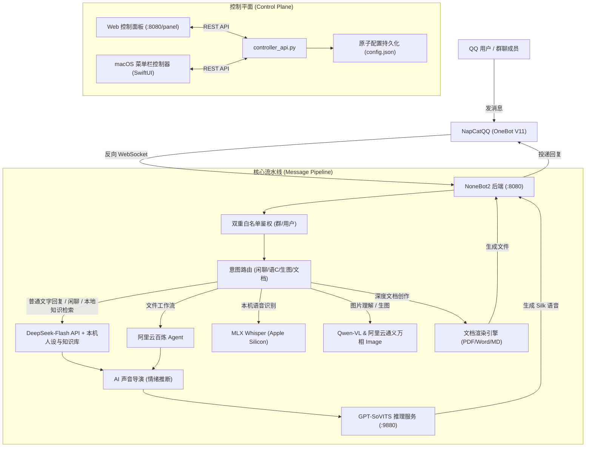
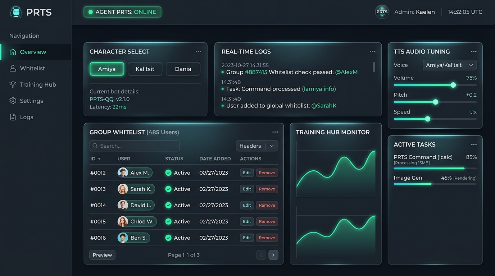

# PRTS // QQ Agent (罗德岛多模态智能体机器人)

> 新用户请先阅读[开始使用与部署说明](GETTING_STARTED.md)：提供手动部署步骤、可复制给 Agent 的部署提示词，以及本地预览图保存位置。

> 基于 **NoneBot2** + **OneBot V11 (NapCatQQ)** + **DeepSeek** + **阿里云百炼 (DashScope)** + **GPT-SoVITS** 构建的高拟真人设干员交互系统、日常极速闲聊接梗引擎、群聊微调训练中心与双端控制中枢。

---

## 🌟 核心特性概览

* **🎭 多干员沉浸式人设语 C**：
  * 内置**阿米娅（Amiya）**、**达妮娅（Dania）**、**凯尔希（Kal'tsit）**干员知识库与专属预设；
  * 遵循“1～3 句自然短句私聊”硬约束，拒绝说明书式冗长输出与 AI 八股；
  * 支持定向情绪安慰模式（`comfort_mode`），对指定用户优先走共情关怀通道。
* **🐟 日常极速闲聊与大肥鱼接梗模式**：
  * 接入 DeepSeek-Flash 极速模型，平均 5~20 字极速回复；
  * 内置 3 秒全局防刷屏冷却与防死锁设计，群友互动自然流畅。
* **📚 群聊风格实时微调训练中心 (Training Hub)**：
  * 支持一键抓取群聊历史百条上下文，自动清洗 CQ 码、屏蔽敏感词；
  * 自动提炼该群黑话标签，并格式化导出为 SFT 微调数据集（`.jsonl`）。
* **🎙️ GPT-SoVITS 情感多参考与 AI 声音导演**：
  * 搭载声音导演中间件，由大模型自动推理回复台词的最佳情感参考音（日常、鼓励、笑意、战友重逢等）；
  * 支持纯闭口鼻音挣扎音合成（防破音陷波与 TD-PSOLA 锁共振峰）。
* **👁️ 多模态图文解析与视觉 Agent**：
  * 接入 Qwen3-VL-Plus / Qwen-VL-Max，支持群内直接识图提问、角色立绘自动归档。
* **📄 战术文档与教案/论文生成及 QQ 投递**：
  * 支持从聊天中识别深度创作意图（写论文、写教案、战术简报），异步在后台渲染 Markdown、PDF、Word (.docx) 三合一排版文档并投递至 QQ。
* **🛡️ 双层白名单与准入隔离机制**：
  * **群聊白名单隔离**：仅在指定群（`active_groups`）中响应交互；
  * **群友 (群u) 白名单过滤**：开启后仅响应白名单内群成员发言，超级管理员（默认 QQ）自动豁免；支持在控制面板一键读取群成员列表并进行可视化多选与持久化保存。
* **🖥️ 双控制端协同中枢**：
  * **现代 Web 控制面板**（`http://127.0.0.1:8080/panel`）：暗色系、模块化管理、实时进度与日志监控；
  * **原生 macOS 菜单栏控制器**（SwiftUI 编写）：轻量驻留 macOS 顶部菜单栏，随时查看在线状态与一键启停。

---

## 🏗️ 系统架构图



---

## 📸 Web 控制中枢界面

控制面板集成了机器人运行模式切换、群成员白名单可视化多选、群聊训练监控、语音参数微调与实时任务看板：



*访问路径：机器人启动后在浏览器打开 `http://127.0.0.1:8080/panel` 即可直接使用。*

---

## 🚀 快速开始与环境部署

### 1. 克隆代码与创建虚拟环境

```bash
git clone https://github.com/Bniya-cn/qq-agent-workspace.git
cd qq-agent-workspace/bot

# 创建 Python 3.10+ 虚拟环境
python3 -m venv .venv
source .venv/bin/activate

# 安装依赖
pip install -r requirements.txt
```

### 2. 配置环境变量

从示例模板创建你的本地配置文件：

```bash
cp .env.example .env.dev
```

打开 `bot/.env.dev` 并填写你的核心 API 密钥：

```ini
# 核心网络
ENVIRONMENT=dev
DRIVER=~fastapi
HOST=0.0.0.0
PORT=8080

# 鉴权与管理员
SUPERUSER_QQ=你的QQ号
ONEBOT_ACCESS_TOKEN=与NapCat保持一致或留空

# DeepSeek 密钥 (日常闲聊与声音导演)
DEEPSEEK_API_KEY=sk-xxxxxx

# 阿里云百炼 (DashScope) 密钥与应用
DASHSCOPE_API_KEY=sk-xxxxxx
DASHSCOPE_APP_ID_AMIYA=你的阿米娅应用ID (可选)
```

> 完整参数说明与获取指引请参阅 [bot/.env.example](file:///Users/daijinglin/Desktop/qq-agent-workspace/bot/.env.example)。

### 3. 配置 NapCatQQ (OneBot V11 反向 WebSocket)

1. 下载并安装 [NapCatQQ](https://github.com/NapNeko/NapCatQQ)；
2. 登录用于机器人的小号 QQ；
3. 打开 NapCat WebUI（默认端口通常为 `6099`），进入【网络配置】->【新建反向 WebSocket】；
4. 填写如下连接信息并保存：
   * **URL 地址**：`ws://127.0.0.1:8080/onebot/v11/ws`
   * **通信协议**：`OneBot V11`
   * **Token / Access Token**：与 `.env.dev` 中的 `ONEBOT_ACCESS_TOKEN` 一致（若留空则两边都不填）
   * **重连间隔**：`3000` 毫秒

### 4. 启动服务

在项目根目录下，直接运行一键启动脚本：

```bash
./start_all.sh
```

或者单独进入 `bot/` 运行：

```bash
cd bot
source .venv/bin/activate
python bot.py
```

终端打印 `[INFO] Application startup complete.` 即表示后端初始化成功！

---

## 🎮 控制面板功能指南 (`/panel`)

打开浏览器访问 `http://127.0.0.1:8080/panel`：

1. **机器人全局状态与模式切换**：
   * **全局响应开关**：一键切换机器人全局工作或静默；
   * **干员人设选择**：支持阿米娅、达妮娅、凯尔希或纯粹闲聊模式秒级热切换；
2. **🛡️ 群聊成员白名单过滤管理 (新特性)**：
   * **总开关 Toggle**：开启后群内只响应白名单内的群成员发言；
   * **读取群成员**：选择白名单群号，点击【🔄 读取群成员】一键拉取该群全部成员；
   * **模糊搜索与批量多选**：支持搜索群名片/QQ号，一键全选、清空、反选，点击卡片直接勾选；
   * **保存生效**：点击【💾 保存该群白名单】即时持久化到本地。
3. **📚 群聊风格实时训练中心 (Training Hub)**：
   * 输入目标群号，点击【⚡ 抓取120条并训练】，自动生成微调对话对；
4. **🎙️ 语音合成与参数调音台**：
   * 在线检测 `9880` 语音服务状态，支持调整语速、采样温度 Top-P 与固定参考音频预览；
5. **实时日志与进度监控器**：
   * 实时回显生图、文档渲染、语音生成的百分比进度条与最近交互事件。

---

## 🖥️ macOS 原生控制端 (可选)

本项目在 `macos-controller/` 目录下提供了基于 SwiftUI 编写的原生 macOS 菜单栏控制端：

```bash
cd macos-controller
./build_app.sh
```

编译生成 `QQAgentController.app` 后直接双击运行，即可在 Mac 顶部菜单栏实现无需打开浏览器的常驻状态查看与一键操控。

---

## 📄 开源与免责声明

* 本项目基于开源框架 [NoneBot2](https://github.com/nonebot/nonebot2) 与通信协议 [OneBot 11](https://github.com/botuniverse/onebot-11) 构建；
* 项目中的角色立绘、台词资料仅供个人学习与同好交流使用，相关知识产权归《明日方舟》及上海鹰角网络科技有限公司所有；
* 本仓库严格遵循开源安全规范，所有个人 API Key、QQ 号、聊天记录与模型权重文件均在 `.gitignore` 保护范围，不会向公共代码库提交任何私密数据。

---

## 🔗 开源项目与致谢 (Acknowledgments)

本项目深度依托以下优秀开源项目与社区生态，特此致谢：

| 开源项目 | 作用与定位 | 仓库地址 |
| :--- | :--- | :--- |
| **NoneBot2** | 跨平台 Python 异步机器人开发框架 | [nonebot/nonebot2](https://github.com/nonebot/nonebot2) |
| **nonebot-adapter-onebot** | OneBot V11 协议适配层 | [nonebot/adapter-onebot](https://github.com/nonebot/adapter-onebot) |
| **OneBot 11** | 统一聊天机器人通信协议规范 | [botuniverse/onebot-11](https://github.com/botuniverse/onebot-11) |
| **NapCatQQ** | 现代化、高性能的 QQ 协议端 (OneBot V11 实现) | [NapNeko/NapCatQQ](https://github.com/NapNeko/NapCatQQ) |
| **GPT-SoVITS** | 少样本跨语种语音克隆与 TTS 合成引擎 | [RVC-Boss/GPT-SoVITS](https://github.com/RVC-Boss/GPT-SoVITS) |
| **FastAPI** | 高性能 Web 框架 (驱动内置控制面板与 API 路由) | [fastapi/fastapi](https://github.com/fastapi/fastapi) |
| **Pydantic** | 数据校验与配置结构化 | [pydantic/pydantic](https://github.com/pydantic/pydantic) |
| **python-docx** | 战术排版与 Word (.docx) 文档渲染生成 | [python-openxml/python-docx](https://github.com/python-openxml/python-docx) |
| **ReportLab** | 战术分页与 PDF 渲染引擎 | [reportlab/reportlab](https://www.reportlab.com/) |
| **silk-v3-decoder** | QQ 原生 Silk 语音编解码支持 | [kn007/silk-v3-decoder](https://github.com/kn007/silk-v3-decoder) |
| **Tailwind CSS** | Web 控制中枢现代化暗色 UI 设计系统 | [tailwindlabs/tailwindcss](https://github.com/tailwindlabs/tailwindcss) |
